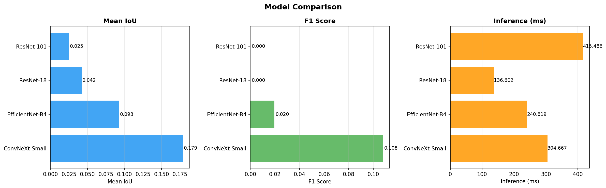
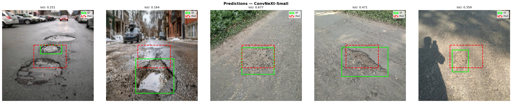

# Pothole Detection with Deep Learning

MSc Data Science dissertation project (University of Hertfordshire).
Compares four pre-trained CNN backbones for locating potholes in road
images, and deploys the best one in a Streamlit app.

## Models compared
ResNet-18, ResNet-101, EfficientNet-B4, ConvNeXt-Small (via timm, PyTorch).

## Data
Two public Kaggle pothole datasets (one XML-annotated, one CSV-annotated),
combined, filtered for invalid bounding boxes, and split 90/10
(stratified by source). Images resized to 128x128.
The data is not included in this repo.
Source (as cited in the dissertation): https://www.kaggle.com/code/ameypatil07/pothole-detection

## Method
- Bounding-box regression with transfer learning (ImageNet weights)
- Two-phase training: frozen backbone, then full fine-tuning
- Loss: GIoU + Smooth-L1; cosine annealing; early stopping (patience 3)
- Augmentation with Albumentations
- Max 5 epochs, CPU only

## Results (validation set)
| Model | Mean IoU | F1 | Inference (ms/batch of 5, CPU) |
|---|---|---|---|
| ConvNeXt-Small | 0.1790 | 0.1078 | 304.7 |
| EfficientNet-B4 | 0.0929 | 0.0196 | 240.8 |
| ResNet-18 | 0.0420 | 0.0 | 136.6 |
| ResNet-101 | 0.0252 | 0.0 | 415.5 |

None of the models reached the target of IoU > 0.30. The low scores are
likely due to the 128x128 resolution and short 5-epoch training on CPU,
not the approach itself. Higher resolution and longer training are the
next steps.

## Streamlit app
The final cells of the notebook run a Streamlit app that serves the
best model, exposed via ngrok. To use it, add your own ngrok token.

## How to run
1. Install: pip install torch timm albumentations opencv-python streamlit pyngrok
2. Open pothole_detection.ipynb and run the cells in order.

## Author
Surabhi Keshri
